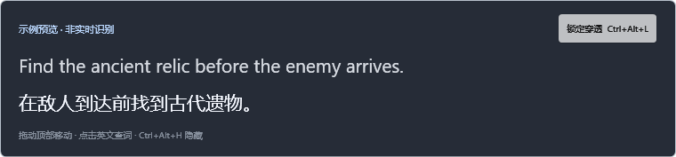
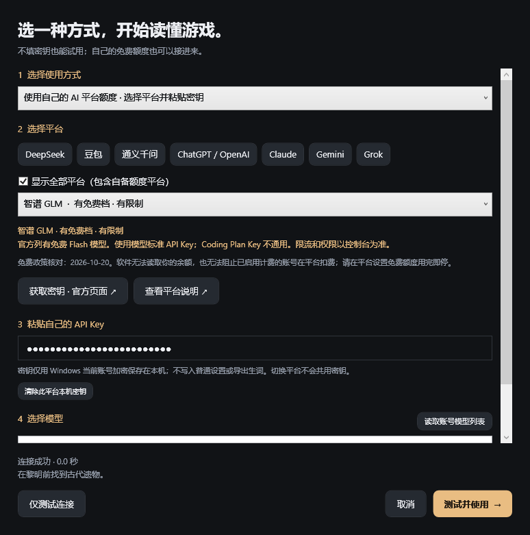

# LexiLens

**在游戏里，读懂每一句。**

LexiLens 是面向语言学习者的 Windows 外置游戏翻译工具。保持游戏的英语环境，遇到看不懂的任务目标、物品说明或对话字幕时，在悬浮窗中查看中文对照，并把陌生单词连同原句一起收藏。

通过系统截图与本地 OCR 识别屏幕文字，无需修改游戏文件或注入游戏进程。

[下载 Windows 版本](https://github.com/observer233/LexiLens/releases/latest) · [使用指南](docs/USER_GUIDE.md) · [English introduction](README.en.md) · [提交问题](https://github.com/observer233/LexiLens/issues)


> 当前为 **v0.3.0 早期可用原型**。新增内置 PaddleOCR v5 增强识别、识别检查和主流 AI 平台快捷接入。已验证桌面练习场完整流程，尚未完成不同游戏、显卡、HDR 和混合 DPI 多屏的兼容性测试。界面中的「示例预览」是固定演示。

## 为什么做这个

很多游戏只能显示一种语言。选择英语能创造学习环境，但不断暂停、切出游戏查词，又容易打断体验。LexiLens 希望提供一层可以随时查看的中文辅助，让玩家继续读英文，也能逐渐积累词汇。

## 已实现

- **区域识别**：在任意一块屏幕上框选任务详情或字幕区域，持续识别；支持负坐标的副屏。
- **本地增强 OCR**：内置 PaddleOCR v5 与 CPU 运行库，默认增强英文/中文；自动放大小字、增强对比度和反色，低置信度时用原图重试。可选择原图、暗底亮字、低对比度模式，保留 Windows OCR 轻量选项。截图不上传、不落盘。
- **检查识别**：查看框选截图、原始识别文字、引擎和耗时，无需调用翻译 API，帮助定位花体误识别。
- **英中对照悬浮窗**：置顶、拖动、调整大小，支持原文开关、文字大小及整体不透明度设置。
- **鼠标穿透**：开始时自动锁定，鼠标操作继续传给游戏；解锁后可移动和点击英文查词。
- **稳定识别与去重**：连续两次识别一致后翻译，相同文本使用内存缓存；新字幕取消旧请求，避免旧译文覆盖新字幕。连续三次空白清空字幕。
- **服务向导**：内置 25 个云平台，默认全部显示；DeepSeek、豆包、千问、ChatGPT/OpenAI、Claude、Gemini、Grok 有快捷按钮。提供候选模型、模型列表读取、地区选择与测试，区分免费档、赠送及自备额度；另有 Ollama 与自定义兼容服务。
- **密钥本机加密**：Windows 当前账号加密保存，平台与地址隔离，不写入普通设置。
- **生词本**：内置一小份原创游戏词汇提示；其他单词调用当前翻译服务。支持编辑释义、保存原句、删除及 CSV 导出。
- **全局快捷键**：开始/暂停、重新框选、显隐悬浮窗、切换鼠标穿透；冲突时界面会提示。
- **练习场**：不打开游戏，也能用真实屏幕 OCR 试用任务句识别流程。



## AI 平台与免费额度

无需账号可先用 MyMemory；已有额度可在主界面点击「选平台 / 接入免费额度」，按向导选择平台、粘贴自己的 API Key、测试并使用。

支持中国和美国常用平台：DeepSeek、火山方舟/豆包、阿里云百炼/千问、智谱、Kimi、MiniMax、阶跃、千帆、混元、星火，以及 OpenAI、Claude、Gemini、Grok、Groq、Mistral、OpenRouter 等。千问可选择北京、新加坡、美国弗吉尼亚、香港；Kimi/MiniMax 可选国内或国际入口。密钥按地址隔离。

免费档候选包含智谱、硅基流动、魔搭、Gemini、Groq、OpenRouter 和 Cloudflare；其余 18 个平台按试用或自备额度分类。需要自己的 API Key 和调用权限，不捆绑公共密钥，不承诺全部免费。网页聊天订阅通常不等于标准 API 余额，需核对平台额度。

[查看 25 个平台的配置、官方入口与验证范围](docs/AI_PLATFORMS.md) · [字体识别说明和实测](docs/OCR.md)



## 快速开始

1. 从 [Releases](https://github.com/observer233/LexiLens/releases/latest) 下载 `LexiLens-v0.3.0-win-x64.zip`，解压后运行 `LexiLens.exe`。自带 .NET、OCR 模型与推理库，无需 Python/Ollama 即可增强识别。
2. 系统需为 **Windows 10 2004 / build 19041 或更高版本，x64**，建议 Windows 11。默认英文/中文增强识别无需 Windows OCR 语言包；其他语言和 Windows 引擎需安装对应 OCR 功能。少数缺少 VC++ x64 运行库的电脑可通过偏好设置中的微软入口安装。
3. 首次在服务向导中选择「直接试用」并测试使用，或填写自己的平台额度。然后点击「打开练习场」，框选英文任务句。
4. 点击「开始翻译」，或按 `Ctrl+Alt+T`。默认通过 MyMemory 联网翻译；识别文字会发送给该服务。
5. 把游戏切换到**无边框窗口或窗口模式**，重新框选任务或字幕位置。
6. 按 `Ctrl+Alt+L` 解锁悬浮窗，点击英文单词查看并收藏；再按一次恢复穿透。

| 快捷键 | 功能 |
| --- | --- |
| `Ctrl+Alt+T` | 开始 / 暂停识别与翻译 |
| `Ctrl+Alt+R` | 重新框选识别区域，会暂停当前会话 |
| `Ctrl+Alt+H` | 显示 / 隐藏悬浮窗；隐藏时会话仍在运行 |
| `Ctrl+Alt+L` | 锁定 / 解锁鼠标穿透 |
| `Esc` | 框选过程中取消选择 |

如果快捷键被其他软件占用，可使用主窗口按钮。尚不支持自定义快捷键。

## 翻译服务和隐私

| 模式 | 需要准备 | 文字去向 | 适用情况 |
| --- | --- | --- | --- |
| MyMemory（默认） | 网络，不需要 API key | MyMemory 第三方服务 | 快速试用、低频任务文本 |
| AI 平台预设 | 自己的标准 API Key 和可用额度 | 所选平台；截图留在本机 | 免费档或自备额度，见平台说明 |
| Ollama 本机地址 | 安装 Ollama 并下载支持中英翻译的模型 | 本机 Ollama | 离线使用；性能取决于模型和硬件 |
| Ollama 远程 HTTPS 地址 | 自己信任的服务和模型 | 配置的远程服务器 | 已有远程推理服务 |

MyMemory 有额度和服务限制，不能保证持续高频字幕翻译。超额或失败会显示错误，**不会将错误信息当作有效译文缓存**；可暂停后重试或切换服务。长文本按 UTF-8 字节限制拆分，可能影响句子连贯性。详见 [MyMemory API](https://mymemory.translated.net/doc/spec.php) 和 [额度说明](https://mymemory.translated.net/doc/usagelimits.php)。

使用本地**翻译模型**：先按 [Ollama 官方说明](https://docs.ollama.com/quickstart) 安装并运行服务，在服务向导选择本地离线，检测本机服务，可点击下载推荐 `qwen2.5:3b`。高级地址默认为 `http://localhost:11434`。本项目只内置 OCR 模型，翻译模型需另行下载，尚未测定 Ollama 模型的翻译质量和速度。接口遵循 [Ollama Chat API](https://docs.ollama.com/api/chat)。

应用不需要管理员权限，不读取游戏内存、不发送按键、不安装驱动。正常使用不保存截图；文字、译文只在运行中的内存里缓存，**主动收藏的单词和原句**以及设置保存在 `%LOCALAPPDATA%\LexiLens`。没有遥测或后台自动启动功能。第三方翻译服务自己的数据政策仍然适用。

## 当前边界

- 这是定时 OCR 辅助翻译，**不是逐帧零延迟翻译**。默认扫描间隔为 700 ms，两次一致才提交；端到端延迟还包括 OCR 和网络或模型推理时间。
- 增强 OCR 改善部分花体和描边，仍可能把 `v/u`、`n/m` 等相近字母认错。8 组生成样张的字符错误率为 Windows 22.7% / 增强 0.8%，这是有限的合成测试，不能代表所有游戏。请先用「检查识别」查看结果；快速消失或被特效遮挡的文字仍可能漏识别。
- 一次识别一个矩形，不自动跟踪游戏窗口，也不支持同一次框选跨显示器。游戏移动、分辨率或屏幕布局改变后请重新框选。
- 独占全屏、受保护画面可能无法截图或显示外部悬浮窗。先切换到无边框窗口模式；游戏自己的保护策略也可能影响使用，不保证所有游戏可用。
- 使用 Windows 的截图排除功能减少悬浮窗被再次 OCR；如果系统拒绝该功能，界面会提示把悬浮窗移到识别区域外。[API 说明](https://learn.microsoft.com/en-us/windows/win32/api/winuser/nf-winuser-setwindowdisplayaffinity)。
- 英文单词点击学习已实现；其他 OCR 语言可以翻译，但未提供对应的分词学习功能。词汇提示是简短学习辅助，不是完整词典。
- 第一版没有游戏术语表、语音、自动复习、安装器或签名，尚无正式的实际游戏兼容性结论。

## 开发

需要 Windows 和 [.NET 10 SDK](https://dotnet.microsoft.com/download/dotnet/10.0)。

```powershell
dotnet restore LexiLens.sln
dotnet build LexiLens.sln -c Release
dotnet test tests/LexiLens.Core.Tests -c Release
dotnet run --project src/LexiLens.App
```

生成自带运行时的 Windows x64 发布包：

```powershell
./scripts/publish.ps1
```

指定 SDK 路径（例如本地独立安装的 SDK）：

```powershell
./scripts/publish.ps1 -DotnetPath 'C:\path\to\dotnet.exe'
```

运行桌面诊断会打开测试窗口、生成 UI 图片、验证本机 OCR、截图、穿透与一次 MyMemory 翻译，**仅发送练习场测试文字**，不读取现有设置和生词：

```powershell
dotnet run --project src/LexiLens.App -- --diagnostics artifacts/diagnostics
Get-Content artifacts/diagnostics/report.json
```

诊断需要可交互的 Windows 桌面、英语 OCR 包和网络；不要在无桌面的 CI 中运行它。通常启动应用时不会运行诊断，也不保存图片。

```text
src/LexiLens.App/       WPF 主界面、悬浮窗、区域选择、Windows OCR 与截图
src/LexiLens.Core/      稳定字幕管线、翻译接口、文本处理、本地存储
tests/                 并发取消、缓存、服务错误、Unicode 拆分和存储测试
scripts/               Windows 发布脚本
docs/                  使用说明与开发记录
```

当前 55 项核心测试通过。云平台协议经过模拟测试，真实账号权限和免费资格需用自己的 Key 测试，尚未逐一验证。GitHub Actions 在 Windows 上编译、运行核心测试；推送 `v*` 标签可自动构建发布包。当前本地验证记录见 [测试说明](docs/TESTING.md)。

## 后续方向

- 按游戏保存识别区域和术语表，改善任务专名的一致性。
- 字幕与任务详情多区域识别，自适应识别稳定时间。
- 持续维护平台预设和免费档政策，完善服务端额度查询与真实账号测试矩阵。
- 生词发音、复习与更方便的 Anki 导出。
- 扩展真实游戏、不同缩放比例和 HDR 环境的测试矩阵。

欢迎通过 Issues 提交具体场景、系统版本和复现步骤。提交截图前请移除账号、聊天等私人信息。

## License

[MIT](LICENSE)。运行时、Windows 组件、Ollama 模型及外部翻译服务分别遵循各自许可和条款。
