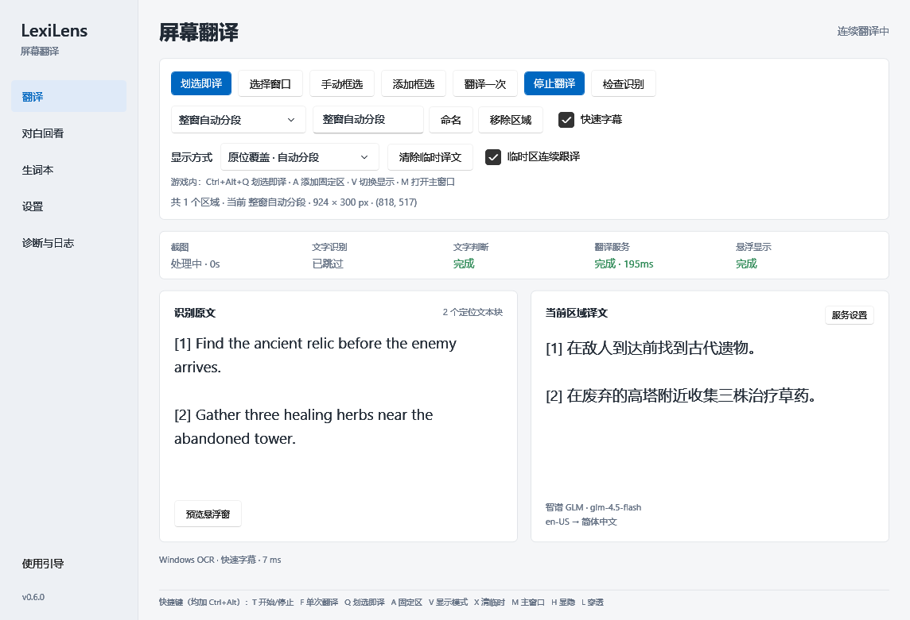
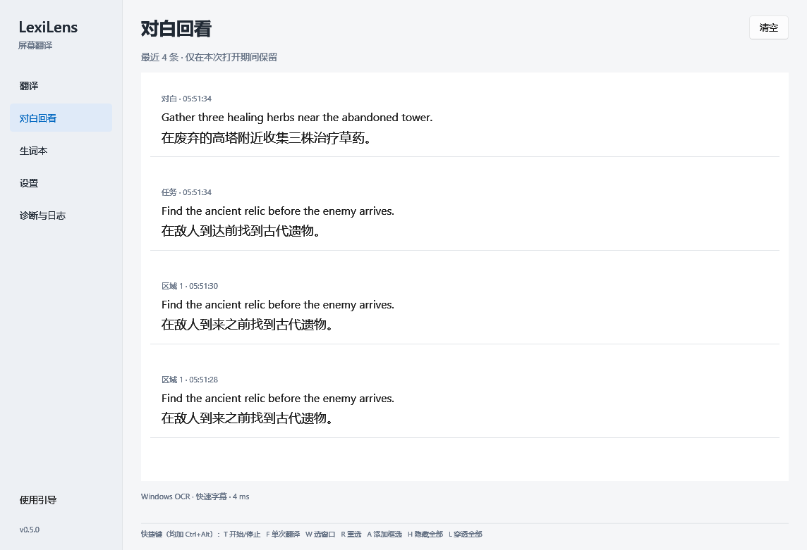
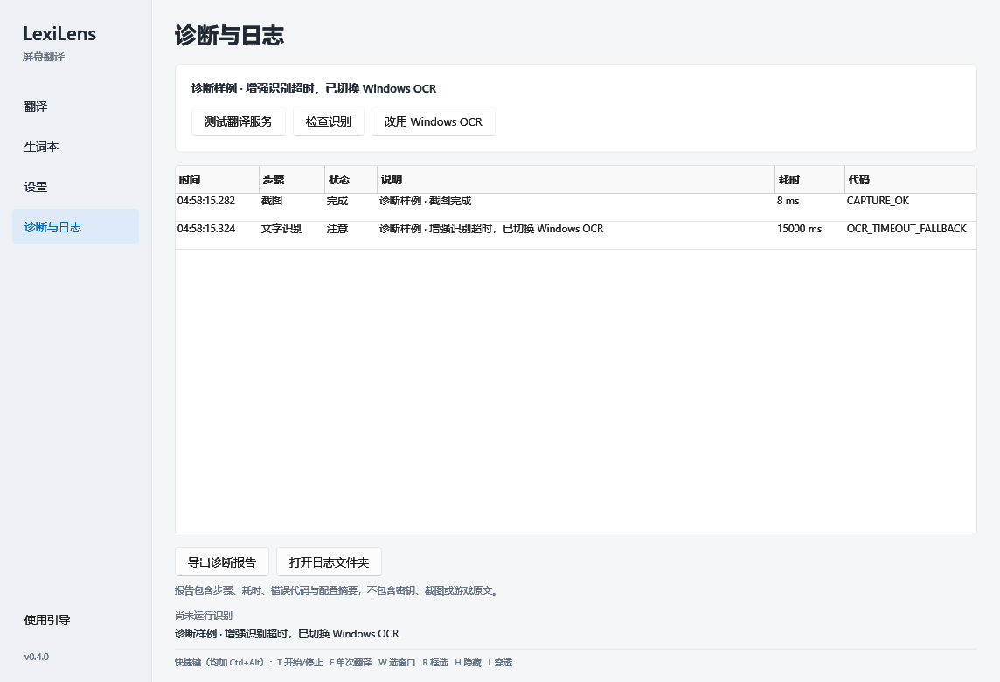

# LexiLens

Windows 屏幕翻译工具。选择游戏窗口或字幕区域，在悬浮窗中查看中文译文，点击英文单词收藏到生词本。

[下载 Windows 版](https://github.com/observer233/LexiLens/releases/latest) · [使用指南](docs/USER_GUIDE.md) · [卡住问题分析](docs/BUG_ANALYSIS.md) · [AI 平台配置](docs/AI_PLATFORMS.md) · [English](README.en.md)



## v0.6.0

- **游戏内划选即译**：Ctrl+Alt+Q 拖出临时区域，松手就识别/翻译，完成选择后交还原窗口焦点，不弹回主界面。X 清除临时结果，M 打开主窗口（均加 Ctrl+Alt）。
- **固定区自动开始**：Ctrl+Alt+A 添加固定区，R 重选当前区，W 选择窗口，选完自动连续翻译。临时划选不改动固定区配置，Esc 取消保留原状态。
- **原位覆盖**：默认保留文字坐标，按行距、字号和横向距离分段，每块在原文位置显示半透明译文。文字消失后撤下对应框，较晚完成的旧译文只进入回看，不盖回新内容。
- **三种显示方式**：原位覆盖、旁置分段、固定悬浮整区合并。Ctrl+Alt+V 直接切换。
- **区域归属**：重叠固定选区优先交给较小的选区；临时划选优先显示，清除后固定区恢复，减少重复覆盖。

## 开始使用

1. 下载 `LexiLens-v0.6.0-win-x64.zip`，完整解压运行 `LexiLens.exe`。自带 .NET 和 OCR 模型，Windows x64，建议 Windows 11。
2. 选择翻译服务并测试保存。已有智谱等额度时选择对应平台，使用自己的标准 API Key。
3. 回到游戏，按 **Ctrl+Alt+Q** 拖选文字，松手即译；再按相同快捷键可重新划选。默认临时区持续跟译；取消“临时区连续跟译”可只翻译当次画面。
4. 需要持续翻译任务/字幕时，按 **Ctrl+Alt+A** 添加固定区域，选完自动开始。最多四个固定区，每个区默认再自动分段。
5. 默认“原位覆盖”，按 **Ctrl+Alt+V** 切换旁置分段/固定悬浮；**Ctrl+Alt+M** 打开主窗口查看回看、设置和日志。

| 快捷键（Ctrl+Alt） | 操作 |
| --- | --- |
| Q | 临时划选，松手即译 |
| A | 添加固定区并自动开始 |
| R / W | 重选当前固定区 / 选整个窗口，自动开始 |
| V | 切换原位覆盖、旁置分段、固定悬浮 |
| X | 清除临时译文，恢复被临时区覆盖的固定文本块 |
| T / F | 开始或停止固定区（停止也清除临时区） / 固定区翻译一次 |
| H / L | 显隐全部译文层 / 切换鼠标穿透 |
| M | 打开主窗口 |

游戏内选择后主窗口保持最小化。Esc 取消选区，已运行的固定区保持原状态。固定选区不跟随游戏窗口移动/缩放，需重新选择。独占全屏游戏可能因外部选区失去焦点；边框/无边框模式需按游戏实际验证。

## 识别和翻译服务

快速自动分段优先使用 Windows OCR，空结果立即撤层；固定悬浮快速模式仍可在空结果时尝试增强引擎。特殊字体可取消“快速字幕”，按所选引擎识别。英文/中文增强模式使用内置 PaddleOCR v5 CPU，支持自动、原图、暗底亮字和低对比度处理；其他语言使用系统 OCR。可手动选择 Windows OCR。置信度是模型分数，特殊花体仍可能认错；点击“检查识别”查看选区和原文。[字体测试](docs/OCR.md)

支持 25 个云平台，以及自定义兼容服务和 Ollama。智谱、DeepSeek、豆包、千问、OpenAI、Claude、Gemini、Grok 等均可使用自己的标准 API Key；平台默认全部显示。免费档、赠送额度、付费 API 分别标注。[配置与验证范围](docs/AI_PLATFORMS.md)

OCR 模型已内置；Ollama **翻译模型**需另行下载。云平台需要自己的权限和额度，不附带公共密钥。截图留在本机，识别文字按用户选择发送至翻译服务。

## 对白回看



## 诊断



服务连接测试成功，只能说明固定测试句可以翻译。实际游戏必须先完成截图和 OCR，才会请求 API。v0.3.0 的严格稳定判断已复现并修复；用户具体设备上的空识别、黑屏或引擎故障需看分步日志确认。[分析记录与错误代码](docs/BUG_ANALYSIS.md)

日志保存在 `%LOCALAPPDATA%\LexiLens\logs`，轮换限制约 4 MB。应用内可导出最近 500 条记录和配置摘要，不包含密钥、服务地址、窗口标题、游戏文字或截图。设置、生词和加密密钥继续保存在 `%LOCALAPPDATA%\LexiLens`。

## 验证与范围

90 项核心测试通过，新增分栏/行距/词框基线聚合、独立译文位置、过期结果保护、坐标抖动去重、识别卡住撤层。桌面诊断覆盖自动分段、原位层、空画面撤层、划选自动翻译、返回练习窗口焦点、Esc 保留状态、重叠归属及固定区自动开始。已在桌面练习窗口验证实际截图、独立进程 OCR、MyMemory 翻译、窗口选择、穿透、故障注入和报告导出。未逐个平台使用真实 API Key，也未完成商业游戏、HDR、混合 DPI、长期资源占用的兼容矩阵。窗口捕获受显示模式和系统保护影响；不是逐帧或零延迟翻译。

原位/旁置模式按 OCR 几何坐标自动分段，不依赖语言模型猜测任务或对白类别；复杂排版仍可能错分。每区默认最多 12 块（设置可调 4–24），超出会记录提示；过长译文受框大小限制，可在回看查看全文。快速模式有识别准确度取舍；未采样到的画面无法补译，云端延迟也无法由本机消除。[速度与队列边界](docs/PERFORMANCE.md)

下载包尚未签名。增强识别需要 VC++ x64 运行库；缺失时可通过设置中的微软入口查看安装说明，有系统 OCR 时会明确提示并切换。

## 开发

Windows、[.NET 10 SDK](https://dotnet.microsoft.com/download/dotnet/10.0)：

```powershell
dotnet build LexiLens.sln -c Release
dotnet test tests/LexiLens.Core.Tests -c Release
dotnet run --project src/LexiLens.App
./scripts/publish.ps1
```

[GitHub 调研与设计参考](docs/RESEARCH.md) · [验证记录](docs/TESTING.md) · [MIT License](LICENSE) · [第三方组件](docs/THIRD_PARTY_NOTICES.md)
